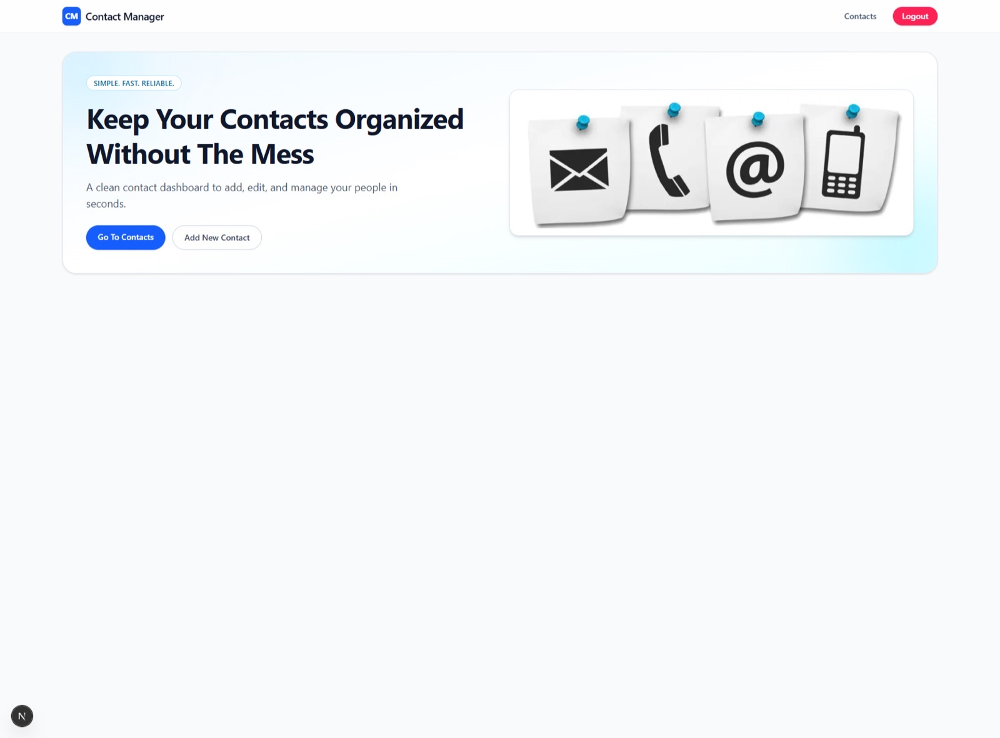

<div align="center">

# 📇 Contact Manager

A contact management app built with the Next.js App Router, server actions and cookie-based authentication.

<a href="https://contact-manager-coral-one.vercel.app/"></a>
<a href="https://github.com/miladmo68/Contact-Manager"></a>
<a href="https://miladweb.com"></a>

**🔗 Live:** [contact-manager-coral-one.vercel.app](https://contact-manager-coral-one.vercel.app/)

</div>

<p align="center">
  
</p>

## ✨ Features

- Register, log in and log out
- Create, edit and delete contacts
- Server actions with cookie-based sessions
- TypeScript and Tailwind CSS

## 🛠️ Tech Stack

     

## 🚀 Getting Started

**Prerequisites:** [Node.js](https://nodejs.org/) 18 or newer

**Install and run**

```bash
git clone https://github.com/miladmo68/Contact-Manager.git
cd Contact-Manager
npm install
npm run server   # starts the mock API (json-server)
npm run dev      # in a second terminal
```

### Environment variables

Create a `.env` file (or `.env.local` for Next.js) with:

```env
NEXT_PUBLIC_API_URL=
```

## 📁 Project Structure

```
Contact-Manager/
├── app/
├── public/
├── eslint.config.mjs
├── next.config.ts
├── package.json
├── postcss.config.mjs
└── tsconfig.json
```

## 👤 Author

**Milad Mohammadi** — Frontend-Focused Full-Stack Developer, Toronto 🇨🇦

[](https://miladweb.com)
[](https://www.linkedin.com/in/miladmo68/)
[](https://github.com/miladmo68)

<p align="center"><sub>If you like this project, consider giving it a ⭐</sub></p>
